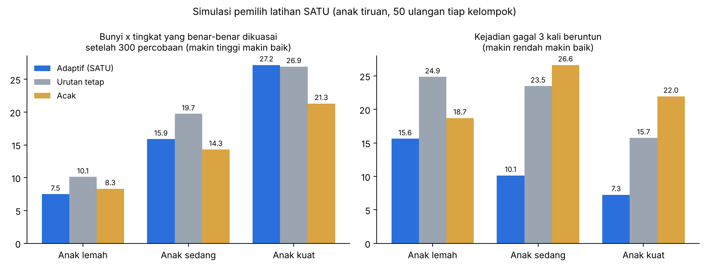

# Simulasi pemilih latihan SATU

Dibuat oleh `backend/skrip/simulasi_otak.py`. Anak tiruan, bukan data anak sungguhan.

Tiga cara memilih latihan dibandingkan pada anak tiruan lemah, sedang, dan kuat, masing-masing
300 percobaan dan 50 ulangan:

- **Adaptif (SATU):** pemilih latihan Otak.
- **Urutan tetap:** urut kurikulum, pindah setelah 3 berhasil beruntun atau 10 percobaan.
- **Acak:** latihan dipilih acak dari semua item.

Anak tiruan punya penguasaan asli yang tersembunyi dari Otak, dan belajar jauh lebih lambat
kalau dilatih tingkat yang prasyaratnya belum dikuasai. Angka anak tiruan sengaja berbeda dari
parameter BKT Otak.

| Anak | Cara | Dikuasai | Tingkat berhasil | Blok 10 percobaan di zona 60-90% | Gagal 3x beruntun |
| --- | --- | --- | --- | --- | --- |
| Lemah | Adaptif (SATU) | 7,5 | 50% | 44% | 15,6 |
| Lemah | Urutan tetap | 10,1 | 21% | 4% | 24,9 |
| Lemah | Acak | 8,3 | 8% | 0% | 18,7 |
| Sedang | Adaptif (SATU) | 15,9 | 59% | 65% | 10,1 |
| Sedang | Urutan tetap | 19,7 | 39% | 25% | 23,5 |
| Sedang | Acak | 14,3 | 20% | 3% | 26,6 |
| Kuat | Adaptif (SATU) | 27,2 | 65% | 80% | 7,3 |
| Kuat | Urutan tetap | 26,9 | 60% | 55% | 15,7 |
| Kuat | Acak | 21,3 | 38% | 27% | 22,0 |

## Kesimpulan yang jujur

- **Frustrasi turun sekitar separuh.** Dibanding urutan tetap, kejadian gagal tiga kali
  beruntun turun dari 24,9 ke 15,6 (lemah), 23,5 ke 10,1 (sedang), dan 15,7 ke 7,3 (kuat).
- **Tingkat berhasil lebih dekat ke zona belajar.** Pada anak sedang, 65% blok latihan berada di
  zona, dibanding 25% dengan urutan tetap.
- **Untuk anak kuat, yang dikuasai setara** dengan urutan tetap (27,2 vs 26,9).
- **Untuk anak lemah dan sedang, urutan tetap masih menguasai sedikit lebih banyak**
  (10,1 vs 7,5 dan 19,7 vs 15,9), dengan harga frustrasi yang jauh lebih tinggi dan tingkat
  berhasil 21% dan 39%. Pemilih SATU sengaja menukar sebagian kecepatan dengan menjaga anak
  tidak terus-menerus gagal.

## Yang diubah karena simulasi ini

Versi pertama pemilih hanya menguasai 6,2 / 10,9 / 23,2. Tiga perubahan menaikkannya 20-46%:

1. Latihan dianggap selesai sementara saat "sudah bisa" (85%), tidak menunggu 95%.
2. Level berikutnya terbuka di 40%, bukan 60%.
3. Latihan penguatan (yang mudah) diselingi, tidak pernah dua kali berturut-turut.
